<p align="center">
  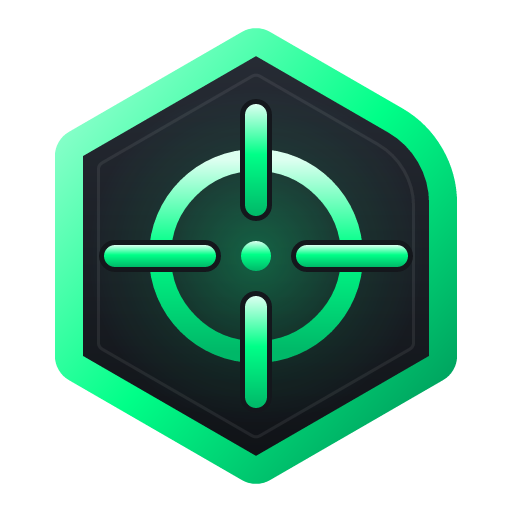
</p>

<h1 align="center">NeoCross</h1>

<p align="center">
  <b>A minimalist, click-through crosshair overlay with 21 crosshairs, built in pure Rust.</b><br>
  For games without a crosshair, or when you want the same aiming point everywhere.<br>
  One small native app for Windows, macOS and Linux. No telemetry, no network, no bloat.
</p>

<p align="center">
  
  
  
  
  <a href="https://github.com/T-G0W/NeoCross/releases/latest"></a>
  <a href="https://github.com/T-G0W/NeoCross/releases"></a>
  <a href="https://github.com/T-G0W/NeoCross/issues"></a>
</p>

<p align="center">
  <a href="https://github.com/T-G0W/NeoCross/releases/latest"></a>
  &nbsp;
  <a href="https://github.com/T-G0W/NeoCross/releases/latest"></a>
  &nbsp;
  <a href="https://github.com/T-G0W/NeoCross/releases/latest"></a>
</p>

<br>

<p align="center">
  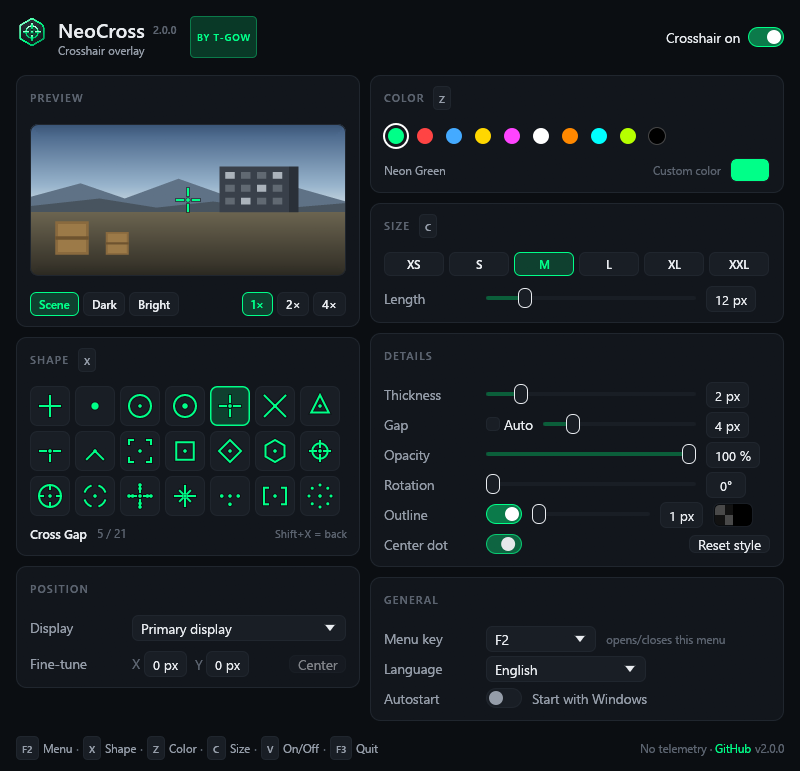
  <br>
  <sub>The whole menu: live preview, 21 shapes, colors, size, details, position and general settings. Every image here is rendered by NeoCross itself.</sub>
</p>

> [!NOTE]
> **NeoCross 2.0 is a complete rewrite of NeoCross 1.x in Rust.** It keeps everything you know (the seven crosshairs, the eight colors, the six sizes and the F2, Z, C, X, F3 hotkeys) and picks up your 1.x settings automatically.

<p align="center">
  <a href="#crosshairs">Crosshairs</a> ·
  <a href="#the-menu">The menu</a> ·
  <a href="#hotkeys">Hotkeys</a> ·
  <a href="#tray-icon">Tray icon</a> ·
  <a href="#get-started">Get started</a> ·
  <a href="#coming-from-neocross-1x">Coming from 1.x</a> ·
  <a href="#under-the-hood">Under the hood</a> ·
  <a href="#build-from-source">Build</a> ·
  <a href="#bugs-ideas-and-feedback">Feedback</a> ·
  <a href="#license-and-credits">License</a>
</p>

<br>

<table>
  <tr>
    <td width="25%" valign="top">
      <h3>🎯 21 crosshairs</h3>
      The seven classics plus fourteen new ones, from T-Shape and Chevron to Scope, Mil-Dot and Halo. Size, thickness, gap, opacity, rotation, outline and center dot are yours to tune.
    </td>
    <td width="25%" valign="top">
      <h3>🖱️ Never in the way</h3>
      Click-through, always on top, never takes focus, never shows in the taskbar. Your mouse and keyboard keep going straight to the game.
    </td>
    <td width="25%" valign="top">
      <h3>⚡ Tiny and native</h3>
      About 2&nbsp;MB of private memory while the menu is closed, no GPU, no runtime, zero CPU while nothing changes. A single 6&nbsp;MB executable.
    </td>
    <td width="25%" valign="top">
      <h3>🔒 Yours, offline</h3>
      No telemetry, no accounts, no network access at all. Open source under MIT or Apache-2.0; your settings are one small JSON file on your computer.
    </td>
  </tr>
</table>

<br>

## Crosshairs

<p align="center">
  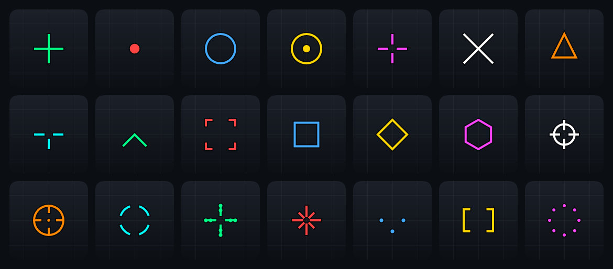
</p>

Every crosshair is drawn pixel-exact: lines land on whole pixels, both halves of a cross are the same length, and the aim point is the true center of your screen. Pick one in the menu, with **X** while the menu is open, or from the tray icon.

<table>
  <tr>
    <td align="center" width="33%"><b>Plus</b><br>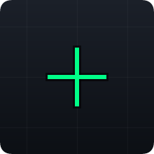<br><i>Classic cross</i></td>
    <td align="center" width="33%"><b>Dot</b><br>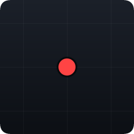<br><i>Minimal center point</i></td>
    <td align="center" width="33%"><b>Circle</b><br>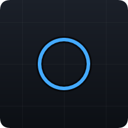<br><i>Clean ring</i></td>
  </tr>
  <tr>
    <td align="center"><b>Circle + Dot</b><br>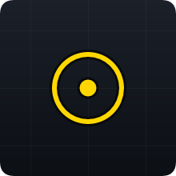<br><i>Precision hybrid</i></td>
    <td align="center"><b>Cross Gap</b><br>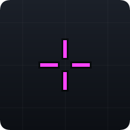<br><i>Separated lines</i></td>
    <td align="center"><b>X-Shape</b><br>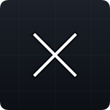<br><i>Diagonal cross</i></td>
  </tr>
  <tr>
    <td align="center"><b>Triangle</b><br>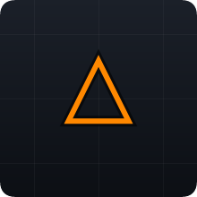<br><i>Angled precision</i></td>
    <td align="center"><b>T-Shape</b> <sup>new</sup><br>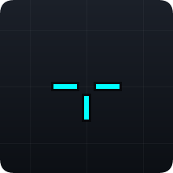<br><i>Cross gap without the top arm</i></td>
    <td align="center"><b>Chevron</b> <sup>new</sup><br>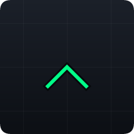<br><i>The tip is the aim point</i></td>
  </tr>
  <tr>
    <td align="center"><b>Corners</b> <sup>new</sup><br>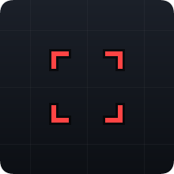<br><i>Four brackets frame the target</i></td>
    <td align="center"><b>Square</b> <sup>new</sup><br>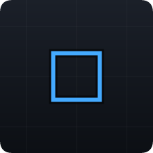<br><i>Box frame</i></td>
    <td align="center"><b>Diamond</b> <sup>new</sup><br>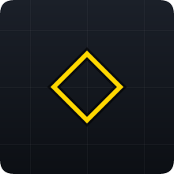<br><i>Square on its tip</i></td>
  </tr>
  <tr>
    <td align="center"><b>Hexagon</b> <sup>new</sup><br>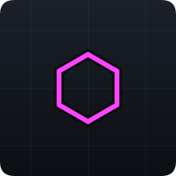<br><i>The T-GOW shape</i></td>
    <td align="center"><b>Scope</b> <sup>new</sup><br>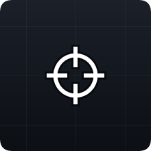<br><i>Ring with crossing arms</i></td>
    <td align="center"><b>Reticle</b> <sup>new</sup><br>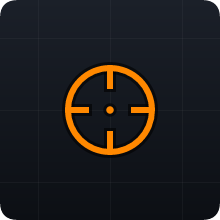<br><i>Ring, inner ticks and dot</i></td>
  </tr>
  <tr>
    <td align="center"><b>Segments</b> <sup>new</sup><br>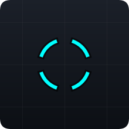<br><i>Broken ring</i></td>
    <td align="center"><b>Mil-Dot</b> <sup>new</sup><br>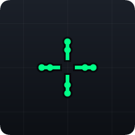<br><i>Ranging dots on the arms</i></td>
    <td align="center"><b>Star</b> <sup>new</sup><br>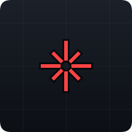<br><i>Eight arms</i></td>
  </tr>
  <tr>
    <td align="center"><b>Tri-Dot</b> <sup>new</sup><br>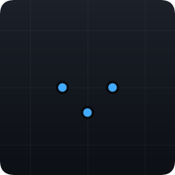<br><i>Three dots around the aim point</i></td>
    <td align="center"><b>Brackets</b> <sup>new</sup><br>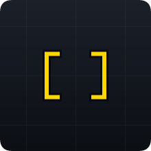<br><i>[ ] around the center</i></td>
    <td align="center"><b>Halo</b> <sup>new</sup><br>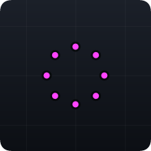<br><i>Ring of eight dots</i></td>
  </tr>
</table>

<br>

## The menu

Open it with **F2** (or the key you choose), from the tray icon, or by starting NeoCross again. Opened by its key, the menu does not take focus away from your game, so you can keep cycling with Z, C and X while you watch the crosshair change.

<table>
  <tr>
    <td width="50%" valign="top">
      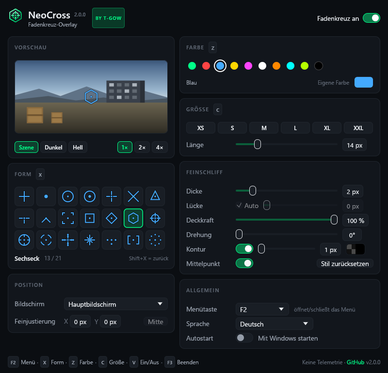
      <br>
      <sub>The menu in German. NeoCross follows your system language and can be switched at any time.</sub>
    </td>
    <td width="50%" valign="top">
      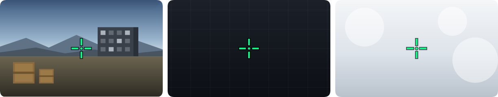
      <br>
      <sub>The preview backgrounds: a crosshair has to read on dark, bright and busy scenes.</sub>
    </td>
  </tr>
</table>

- **Preview:** the crosshair at its real size on a game scene, a dark or a bright background, with 2× and 4× zoom to check every pixel.
- **Shape:** all 21 crosshairs as live thumbnails in your color.
- **Color:** the eight colors of 1.x plus Lime and Black, or any color from the color picker.
- **Size:** the six presets XS to XXL (5 to 30 px), or any length from 2 to 64 px.
- **Details:** thickness, gap (automatic or your own), opacity, rotation, outline with width, color and transparency, and a center dot for every shape.
- **Position:** the display the crosshair sits on, and a pixel-exact fine-tune for games whose aim point is not quite in the middle.
- **General:** menu key, language and start with the system. *Reset style* brings shape, color and sliders back to the defaults.

Close the menu with the menu key or the window's close button; the crosshair keeps running.

<br>

## Hotkeys

The keys are read the way games read them, as raw input: nothing is hooked, nothing is blocked, and the game still receives every key you press.

| Key | Action | When |
|-----|--------|------|
| **F2** | Open or close the menu (changeable in the menu) | Always |
| **X** | Next shape, **Shift+X** previous | Menu open |
| **Z** | Next color, **Shift+Z** previous | Menu open |
| **C** | Next size, **Shift+C** smaller | Menu open |
| **V** | Crosshair on or off | Menu open |
| **F3** | Quit NeoCross | Menu open |

On macOS and Linux the system reserves a key for the program that registered it, so Z, C, X, V and F3 are only taken while the menu is open.

<br>

## Tray icon

NeoCross lives in the notification area (Windows), the menu bar (macOS) or the system tray (Linux). Click it to open the menu; right-click for quick access:

- Open menu, crosshair on or off
- **Shape**, **Color** and **Size** submenus with the current choice checked
- Start with Windows / at login
- NeoCross on GitHub, Quit

> [!TIP]
> Windows puts new tray icons under the **^** arrow (hidden icons). To keep NeoCross visible, drag its icon onto the taskbar, or turn it on under **Settings › Personalization › Taskbar › Other system tray icons**.

<br>

## Get started

### Windows 10 and 11

1. Download **`NeoCross-Setup-<version>.exe`** from the [releases page](https://github.com/T-G0W/NeoCross/releases/latest) and run it. One setup covers 64- and 32-bit Windows and needs no administrator rights.
2. NeoCross starts with the menu open; pick a crosshair and press **F2**. Done.

Prefer no installation? Take **`NeoCross-<version>-windows-x64-portable.zip`**, unpack it anywhere and run `NeoCross.exe`.

> [!TIP]
> Windows SmartScreen may show "Unknown publisher" the first time, because the setup is not signed with a paid code-signing certificate. Choose **More info › Run anyway**.

### macOS 11 or newer (Intel and Apple silicon)

1. Download **`NeoCross-<version>-macos.dmg`**, open it and drag NeoCross into *Applications*.
2. The app is not notarized by Apple, so the first start needs a right-click on NeoCross › **Open** › **Open**.

### Linux (X11 and XWayland)

- **Debian, Ubuntu, Mint, Pop!_OS:** `sudo apt install ./neocross_<version>-1_amd64.deb`
- **Fedora, openSUSE:** `sudo dnf install ./neocross-<version>-1.x86_64.rpm`
- **Any distribution:** unpack `NeoCross-<version>-linux-x86_64.tar.gz` and run `./install.sh` (installs for your user, no root).

On Wayland, NeoCross runs through XWayland, because Wayland lets no program place a window or make it click-through. The tray icon needs a desktop with AppIndicator support (on GNOME the *AppIndicator* extension).

> [!IMPORTANT]
> Overlays are visible over games in **windowed** and **borderless fullscreen** mode. Exclusive fullscreen hides every overlay; switch the game to borderless if the crosshair disappears. Some competitive games do not allow crosshair overlays; check the rules of the games you play.

Your settings live in `%APPDATA%\T-GOW\NeoCross` (Windows), `~/Library/Application Support/T-GOW/NeoCross` (macOS) or `~/.config/neocross` (Linux). Set the environment variable `NEOCROSS_DATA_DIR` for a portable setup.

<br>

## Coming from NeoCross 1.x

- Your shape, color and size from 1.x (`%APPDATA%\NeoCross\settings.json`) are taken over on the first start.
- The hotkeys are the same: **F2** menu, **Z** color, **C** size, **X** shape, **F3** quit.
- The seven crosshairs, eight colors and six sizes are all still there, in the same order.
- Uninstall NeoCross 1.x under **Settings › Apps** before or after installing 2.0; the two don't share files.

| | NeoCross 1.x | NeoCross 2.0 |
|---|---|---|
| Written in | Python + PyQt5 | Rust |
| Download | 38.7 MB setup | 5.7 MB setup (x64 + x86), 2.7 MB portable zip |
| Crosshairs | 7 | 21 |
| Colors | 8 fixed | 10 presets + any color |
| Sizes | 6 presets | 6 presets + 2 to 64 px |
| Thickness, gap, opacity, rotation, outline, center dot | – | ✓ |
| Monitor choice, fine-tuning | – | ✓ |
| Tray icon, autostart, single instance | – | ✓ |
| Keys | polled every 40 ms | raw input, event driven |
| Platforms | Windows | Windows, macOS, Linux |
| License | personal use only, closed | open source, MIT OR Apache-2.0 |

<br>

## Under the hood

- **Crosshair:** one renderer for everything, built on [tiny-skia](https://github.com/RazrFalcon/tiny-skia). The overlay, the menu previews and every image in this README are drawn by the same code, so what you see is exactly what you get.
- **Windows overlay:** a layered, click-through, topmost tool window that never activates. It is drawn on the CPU and handed to the compositor with `UpdateLayeredWindow` and per-pixel alpha: no GPU context, no frame loop, no CPU while nothing changes. A light timer keeps it on top of games that grab the topmost spot and follows display changes.
- **Keyboard:** Raw Input with `RIDEV_INPUTSINK` on Windows: no hook, no injected code, no key ever blocked. Global hotkeys through [global-hotkey](https://github.com/tauri-apps/global-hotkey) on macOS and Linux.
- **Menu:** [egui](https://github.com/emilk/egui) / eframe on OpenGL. On Windows the menu is its own process that only exists while it is open. The OpenGL driver keeps its memory until a process ends, so closing the menu really gives it back, and the part that runs all day stays at about 2 MB of private memory.
- **Tray:** [tray-icon](https://github.com/tauri-apps/tray-icon) with native menus on every platform.
- **macOS and Linux overlay:** a transparent, click-through, always-on-top egui viewport.
- **Distribution:** an Inno Setup installer that picks the right build for 32- or 64-bit Windows, a universal macOS app in a disk image, `.deb`, `.rpm` and a user-level `.tar.gz` for Linux, all built by GitHub Actions on every tag.

<br>

## Build from source

Requirements: [Rust](https://rustup.rs) (stable). On Windows the MSVC toolchain; on Linux `libgtk-3-dev`, `libxdo-dev` and `libayatana-appindicator3-dev`.

```bash
cargo build --release
```

```bash
cargo test
```

Release packages go to `dist/release`:

```bash
powershell -ExecutionPolicy Bypass -File release/build-release.ps1
```

```bash
sh packaging/linux/package.sh
```

```bash
sh packaging/macos/bundle.sh
```

The README images are rendered by NeoCross itself:

```bash
cargo run --release --features docs -- --docs docs/images
```

The logo and icons come from `assets/logo.svg` and `assets/logo-small.svg`:

```bash
cargo run --release --manifest-path tools/logo-render/Cargo.toml
```

Pushing a tag such as `v2.0.0` builds every package and publishes the release on GitHub automatically.

<br>

## Privacy

NeoCross sends no telemetry and never goes online. The only link to the internet is the *GitHub* button, which opens this page in your browser.

<br>

## Bugs, ideas and feedback

NeoCross gets better with your feedback. Please use **[GitHub Issues](https://github.com/T-G0W/NeoCross/issues)** for everything you would like to see fixed, added or changed, including new crosshair ideas.

<p align="center">
  <a href="https://github.com/T-G0W/NeoCross/issues/new?template=bug_report.yml"></a>
  &nbsp;
  <a href="https://github.com/T-G0W/NeoCross/issues/new?template=feature_request.yml"></a>
</p>

- **Bugs:** what happened, what you expected, the game and its display mode, and your NeoCross and system version.
- **Ideas:** new crosshairs (a sketch helps), features, things that feel awkward.
- Take a quick look at the [open issues](https://github.com/T-G0W/NeoCross/issues) first. If someone already asked for the same thing, a 👍 reaction is enough and helps to prioritise.

Issues are welcome in English or German.

<br>

## License and credits

NeoCross is © 2026 T-GOW and dual-licensed under either of

- [MIT License](LICENSE-MIT)
- [Apache License, Version 2.0](LICENSE-APACHE)

at your option. Unless you explicitly state otherwise, any contribution you submit for inclusion in NeoCross is dual-licensed the same way, without any additional terms or conditions.

The licenses of all open-source libraries NeoCross uses are installed alongside the app in `THIRD_PARTY_LICENSES.txt`.

<p align="center"><sub>Made with 🦀 by T-GOW</sub></p>
